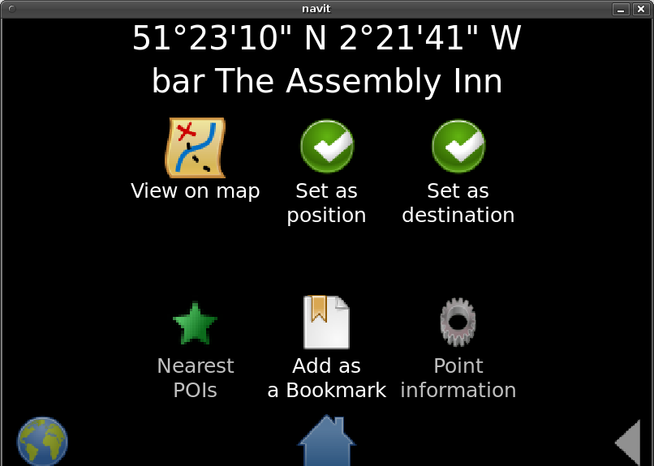

.. _qml_gui:

QML GUI
=======

|Qml_point_20100404.png| The QML GUI (``qml``) is a legacy interface based
on `Qt's modeling language <https://en.wikipedia.org/wiki/QML>`__. It was
designed as a modern, flexible replacement for the Internal GUI and can
run on Qt platforms with touchscreens.

.. warning::

   The QML GUI is unmaintained and buggy. Use the
   :doc:`Internal GUI </user/configuration/Internal_GUI>` or the
   :doc:`Qt5 QML GUI </user/configuration/gui/qt5_qml>` unless you need to
   maintain this legacy interface.

Building
--------

The QML GUI uses Qt 4 (QtCore, QtGui, QtDeclarative and QtXml) and the
``qt_qpainter`` graphics driver. CMake enables the ``qml`` GUI when Qt 4
Declarative support is found; see
:doc:`/development/targets/Dependencies` for packages. There is no need
to build Qt from source just for this GUI.

Enabling the QML GUI
--------------------

Switch the graphics driver to ``qt_qpainter``, enable ``qml`` and disable
all other ``gui`` tags by setting ``enabled="no"``:

.. code:: xml

   <graphics type="qt_qpainter"/>
   <gui type="qml" enabled="yes"/>

``qt_qpainter`` is classified as experimental and less maintained in
:doc:`/user/configuration/basic/display`.

Configuration options
---------------------

The following attributes can be used inside the ``gui`` tag; defaults
are shown in bold:

* **fullscreen**

  * **"0"** - windowed mode (default).
  * "1" - fullscreen mode.

* **menu_on_map_click**

  * "0" - do not open the menu on a map click; this mode was never fully
    implemented.
  * **"1"** - a single map click opens the menu (default).

* **signal_on_map_click**

  * **"0"** - normal map click processing, controlled by
    ``menu_on_map_click`` (default).
  * "1" - send a D-Bus signal instead.

* **radius** - POI search radius in kilometres. Default: **10**.

* **pitch** - starting pitch of the 3D view in degrees. Default: **20**.

* **lazy**

  * "0" - always show the main menu page.
  * **"1"** - show the last used menu page (default).

* **width** / **height** - preferred GUI window size in pixels.
  Defaults: **width="800"** and **height="600"**.

* **source** - directory containing QML skins. Default:
  **NAVIT_SHAREDIR/gui/qml/skins**. Use a full path, not ``~/``.

* **skin** - name of the skin directory to use. Default: **navit**.

* **icon_src** - directory containing menu icons. Default:
  **NAVIT_SHAREDIR/icons/**.

Using the GUI
-------------

A map click or touchscreen tap normally switches to the GUI. That
behaviour is controlled by ``menu_on_map_click`` and
``signal_on_map_click``. The ``lazy`` attribute decides whether the menu
starts at the main page or at the page last used. The current point is
updated after each click.

Skins
-----

A QML skin is a directory containing a QML application. Navit requires
two files:

* ``main.qml`` - the menu entry page.
* ``command.js`` - historically used to handle OSD commands through the
  ``gui.commandFunction`` property. Command dispatch is incomplete in
  current builds.

The rest of the skin structure is up to the skin author. The bundled
skin lives in ``navit/gui/qml/skins/navit/``.

QML API
-------

Navit injects a ``gui`` object into the global QML namespace with the
properties ``width``, ``height``, ``localeName`` (and ``langName`` and
``ctryName``), ``iconPath`` and ``commandFunction``. It also provides
the page-stack slots ``backToMap``, ``pushPage(QString)``, ``popPage()``
and ``lengthPage()``.

Other objects are C++ proxies that bridge QML and Navit's attribute
system. The base proxy provides ``getAttr()`` and ``setAttr()``;
``setAttr()`` converts the strings ``"true"`` and ``"false"`` to ``"1"``
and ``"0"``. The available proxies are:

* **search** - exposes Navit's search API. Set ``searchContext`` to
  ``country``, ``town``, ``street`` or ``number``, put the query in the
  matching ``countryName``, ``countryISO2``, ``townName`` or
  ``streetName`` property, then call ``searchXml()``. The result is XML
  with ``<item>`` elements containing ``<id>``, ``<name>`` and
  ``<icon>``. Searches are hierarchical; starting at a lower level works
  but is slower.
* **gui** - the object described above.
* **bookmarks** - provides ``getAttrList``, ``AddBookmark(name)``,
  ``Cut(name)``, ``Copy(name)``, ``Paste(name)``, ``Delete(name)`` and
  ``setPoint(name)``, plus the ``currentPath`` property. ``getAttrList``
  fills the global ``listModel``. ``setAttr`` and ``getAttr`` are not
  implemented for this proxy.
* **navit** - provides ``quit``, ``setObjectByName(name,value)`` (layout
  and vehicle objects), ``setDestination``, ``setPosition`` and
  ``getAttrList``.
* **vehicle** and **route** - additional proxies exposed by the module.

The current point
~~~~~~~~~~~~~~~~~

The ``point`` object represents a location on the map used by the other
proxies, for example by ``navit.setDestination`` and
``bookmarks.AddBookmark``. It is set by a map click,
``navit.getPosition``, ``navit.getDestination``, ``bookmarks.setPoint``
or ``point.setNewPoint``. Points have the type ``MapPoint``,
``Bookmark``, ``Position``, ``Destination`` or ``PointOfInterest``, and
the properties ``coordString``, ``pointName`` and ``pointType``.

The listModel
~~~~~~~~~~~~~

``getAttrList`` fills a global ``listModel`` based on
``QStandardItemModel``. It defines the roles ``ItemId``, ``ItemName``,
``ItemIcon``, ``ItemPath`` and ``ItemValue``. Only one list model can be
used per page.

