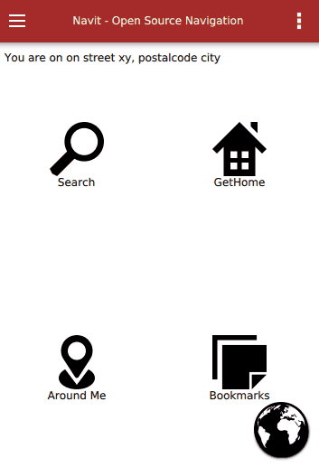

.. _qt5_qml_gui:

Qt5 QML GUI
===========

The Qt5 QML GUI (``qt5_qml``), formerly called QML2, provides a more
modern look and feel than the Internal GUI. It uses Qt 5 Quick and is
built when Qt 5 QML support is enabled.

   Qt5 QML GUI on a tablet or PC

   Qt5 QML GUI drawer popup

Enabling the Qt5 QML GUI
------------------------

Select the Qt 5 graphics driver, enable ``qt5_qml`` and disable other
``gui`` tags such as ``internal``:

.. code-block:: xml

   <graphics type="qt5"/>
   <gui type="internal" enabled="no"/>
   <gui type="qt5_qml" enabled="yes"/>

The ``qt5`` graphics driver can use QWidgets or QML; the ``qt5_qml`` GUI
requires the QML variant. Skins are shipped in
``navit/gui/qt5_qml/skins/``.
